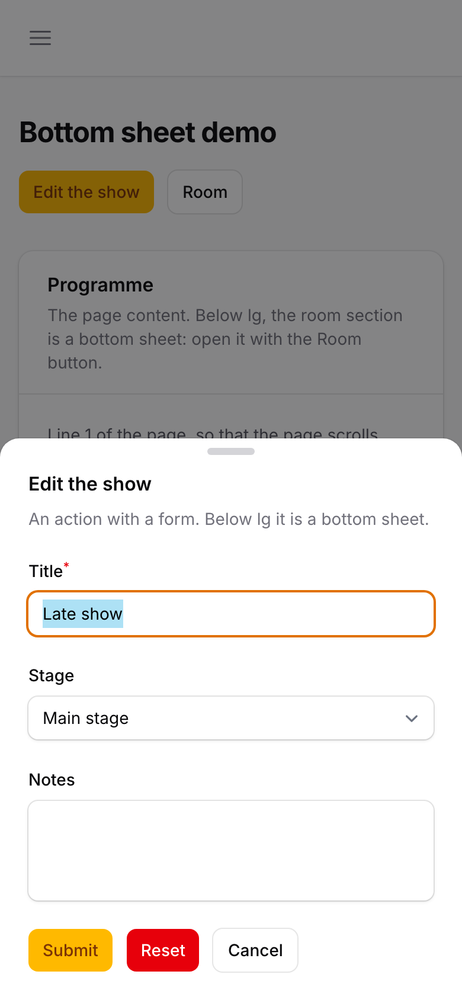
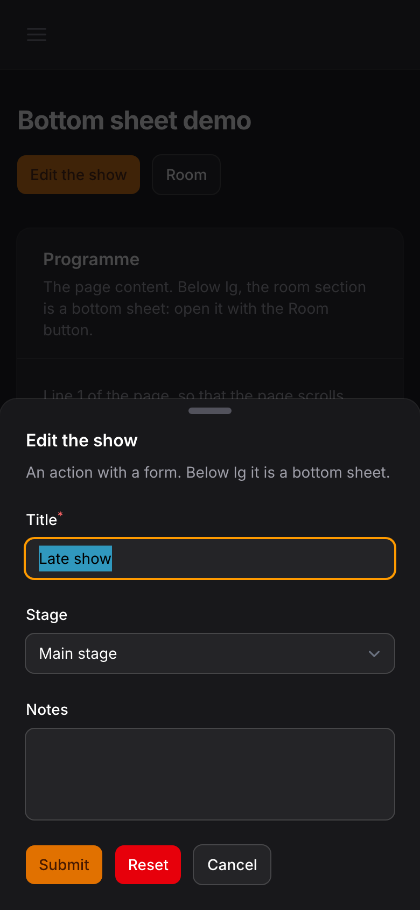

# Bottom sheets for Filament

[](https://packagist.org/packages/vtech9nl/filament-bottom-sheet)
[](https://github.com/VTech9NL/filament-bottom-sheet/actions/workflows/tests.yml)
[](https://packagist.org/packages/vtech9nl/filament-bottom-sheet)
[](LICENSE)

Below a breakpoint, a [Filament](https://filamentphp.com) v5 action or section opens as a native bottom sheet. At and above the breakpoint, the action stays a modal and the section stays in its place.

<picture>
    <source media="(prefers-color-scheme: dark)" srcset="https://raw.githubusercontent.com/VTech9NL/filament-bottom-sheet/main/art/phone-action-dark.png">
    
</picture>

## Features

- **One call.** `->bottomSheet('lg')` on an action or a section.
- **Phone behaviour.** Snap points, drag, flick, scroll and dismiss. A second sheet stacks on the first.
- **Desktop behaviour.** The action is the normal modal. The section shows in its column.
- **Your theme.** The sheet uses Tailwind utilities and the Filament colour tokens.

## Screenshots

| Light | Dark |
| --- | --- |
|  |  |

A nested confirmation stacks on the first sheet:


## Requirements

- PHP 8.3 or higher
- Filament 5
- A custom panel theme that uses Tailwind CSS v4

## Installation

1. Install the package:

    ```bash
    composer require vtech9nl/filament-bottom-sheet
    ```

    Laravel registers the service provider. You add no plugin on the panel.

2. The panel theme needs `@source` for this package. The directive classes live in `resources/js`. The class that hides a section sheet before Alpine starts lives in `src`.

    Open the theme file, for example `resources/css/filament/admin/theme.css`:

    ```css
    @source '../../../../vendor/vtech9nl/filament-bottom-sheet/resources/js';
    @source '../../../../vendor/vtech9nl/filament-bottom-sheet/src';
    ```

3. Build the theme:

    ```bash
    npm run build
    ```

Filament loads the package JavaScript and a small CSS file on each panel.

## Usage

### An action

```php
use Filament\Actions\Action;

Action::make('edit')
    ->schema([
        // ...
    ])
    ->bottomSheet('lg');
```

Below `lg` (64rem), the modal opens as a sheet. At `lg` and above, it is the normal modal.

A nested action that must stack on a sheet needs `->overlayParentActions()`:

```php
Action::make('reset')
    ->requiresConfirmation()
    ->overlayParentActions()
    ->bottomSheet('lg');
```

### A section

A section sheet needs an `id()` or a `key()`. Below the breakpoint the section is hidden until you open it. At the breakpoint and above, it shows in its place and the events do nothing.

```php
use Filament\Actions\Action;
use Filament\Schemas\Components\Section;

Section::make('Room')
    ->id('room')
    ->schema([
        // ...
    ])
    ->footerActions([
        Action::make('save'),
        Action::make('close')
            ->alpineClickHandler("\$dispatch('close-bottom-sheet', { id: 'room' })")
            ->extraAttributes(['class' => 'lg:hidden']),
    ])
    ->bottomSheet('lg');

Action::make('openRoom')
    ->label('Room')
    ->alpineClickHandler("\$dispatch('open-bottom-sheet', { id: 'room' })")
    ->extraAttributes(['class' => 'lg:hidden']);
```

Open the sheet with `$dispatch('open-bottom-sheet', { id })`. Close it with `$dispatch('close-bottom-sheet', { id })`.

While the section is a sheet, its label and its collapse button are hidden. The footer actions stay at the bottom of the sheet.

The sheet sets no `x-data` on the section wrapper. The wrapper can have the `x-data` of the app, for example from `extraAlpineAttributes()`.

### One form, two shells

Use one form class in a section at `lg` and above, and in an action with `->bottomSheet('lg')` below `lg`.

```php
use Filament\Actions\Action;
use Filament\Forms\Components\TextInput;
use Filament\Schemas\Components\Grid;
use Filament\Schemas\Components\Section;

class RoomForm
{
    public static function schema(): array
    {
        return [
            TextInput::make('name'),
        ];
    }
}

Grid::make(['default' => 1, 'lg' => 2])->schema([
    Section::make('Room')
        ->schema(RoomForm::schema())
        ->extraAttributes(['class' => 'max-lg:hidden']),
]);

Action::make('editRoom')
    ->schema(RoomForm::schema())
    ->bottomSheet('lg')
    ->extraAttributes(['class' => 'lg:hidden']);
```

The section sits in the column at `lg` and above. Below `lg`, the action opens the same fields as a sheet.

## Events

| Event | Detail | Effect below the breakpoint |
| --- | --- | --- |
| `open-bottom-sheet` | `{ id }` | Opens the section sheet with that id. |
| `close-bottom-sheet` | `{ id }` | Closes that section sheet. |

At and above the breakpoint, both events do nothing.

## Options

`bottomSheet('lg')` is the short form of `bottomSheet(true, 'lg')`.

| Method | Default | Effect |
| --- | --- | --- |
| `bottomSheet($condition, $until)` | on, `md` | Below `$until`, the part is a sheet. `false`, or a closure that returns `false`, leaves the part unchanged. |
| `bottomSheetSnapPoints($points)` | `[0.5, 0.8, 1.0]` | Heights where the sheet can rest, as parts of the viewport height. |
| `bottomSheetInitialHeight($height)` | `'content'` | `'content'` opens at the height of the header, body and footer, and never above the highest snap point. A number opens at that part of the viewport. When the content height cannot be measured, the sheet opens at `0.5`. |

The breakpoint names are the Tailwind CSS v4 defaults:

| Name | Width |
| --- | --- |
| `sm` | 40rem |
| `md` | 48rem |
| `lg` | 64rem |
| `xl` | 80rem |
| `2xl` | 96rem |

## Limits

- A section sheet uses `position: fixed`. A parent with `transform`, `filter` or `contain` breaks that position. Keep the section outside such a parent.
- A section sheet needs an `id()` or a `key()`, so the open and close events can name it.
- A nested action stacks on a sheet only when it calls `->overlayParentActions()`.
- `composer serve` builds the workbench theme and starts the demo panel.

## Testing

```bash
composer test
vendor/bin/pint --test
```

## Changelog

See [CHANGELOG.md](CHANGELOG.md).

## License

MIT. See [LICENSE](LICENSE).
