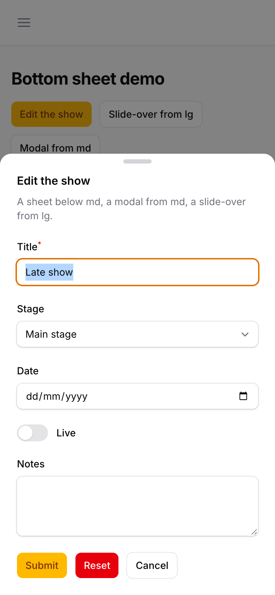
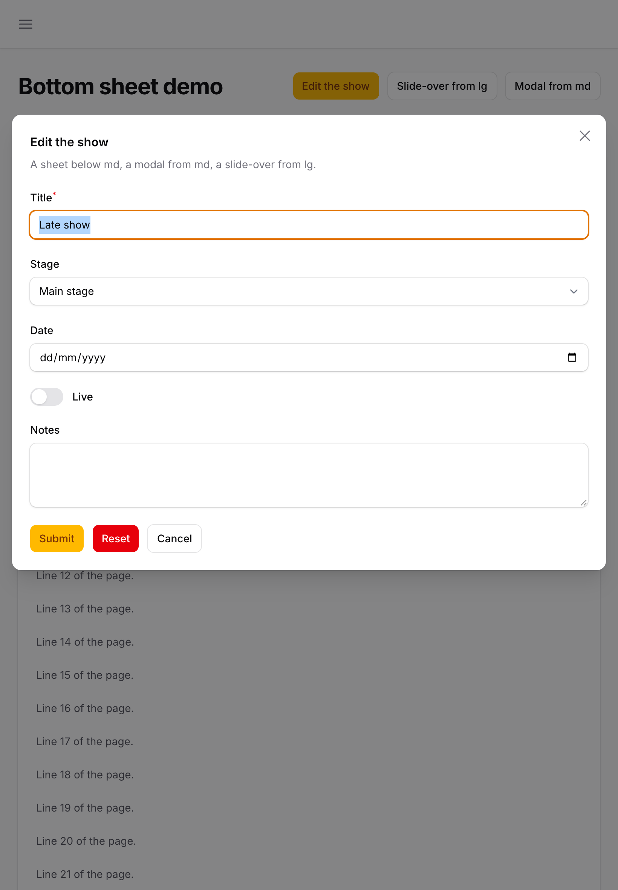
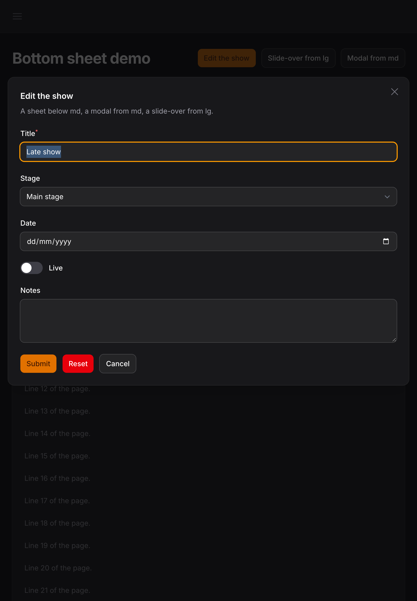
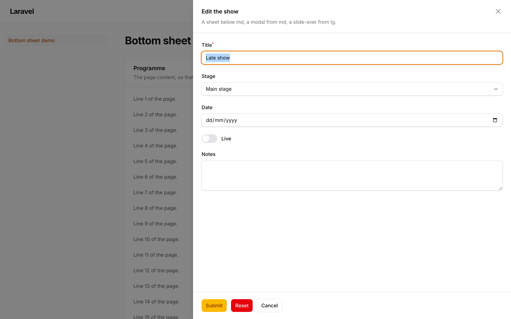

# Bottom sheets for Filament

[](https://packagist.org/packages/vtech9nl/filament-bottom-sheet)
[](https://github.com/VTech9NL/filament-bottom-sheet/actions/workflows/tests.yml)
[](https://packagist.org/packages/vtech9nl/filament-bottom-sheet)
[](LICENSE)

The bottom sheet is the third window type of a [Filament](https://filamentphp.com) v5 action, next to the modal and the slide-over. It is mobile first: `->bottomSheet()` makes the action a native bottom sheet, and `->modalFrom()` and `->slideOverFrom()` change the type from a breakpoint and up.

<picture>
    <source media="(prefers-color-scheme: dark)" srcset="https://raw.githubusercontent.com/VTech9NL/filament-bottom-sheet/main/art/phone-sheet-dark.png">
    
</picture>

## Features

- **One action, three window types.** `->bottomSheet()->modalFrom('md')->slideOverFrom('lg')` is a sheet on a phone, a modal on a tablet and a slide-over on a desktop.
- **Phone behaviour.** Snap points, drag, flick, scroll and dismiss. A second sheet stacks on the first.
- **Filament look.** The modal and the slide-over use the Filament classes, so your theme styles them as Filament does.
- **No close on a resize.** A resize changes the type of an open window. The form data stays.

## Screenshots

The action `->bottomSheet()->modalFrom('md')->slideOverFrom('lg')`:

| Width | Light | Dark |
| --- | --- | --- |
| 390 px, sheet |  |  |
| 820 px, modal |  |  |
| 1440 px, slide-over |  |  |

A nested confirmation stacks on the first sheet:


## Requirements

- PHP 8.3 or higher
- Filament 5
- A custom panel theme that uses Tailwind CSS v4

## Installation

1. Install the package:

    ```bash
    composer require vtech9nl/filament-bottom-sheet
    ```

    Laravel registers the service provider. You add no plugin on the panel.

2. The panel theme needs `@source` for the directive classes of this package.

    Open the theme file, for example `resources/css/filament/admin/theme.css`:

    ```css
    @source '../../../../vendor/vtech9nl/filament-bottom-sheet/resources/js';
    ```

3. Build the theme:

    ```bash
    npm run build
    ```

Filament loads the package JavaScript and a small CSS file on each panel.

## Usage

### A sheet at each width

```php
use Filament\Actions\Action;

Action::make('edit')
    ->schema([
        // ...
    ])
    ->bottomSheet();
```

### A sheet, then a slide-over

```php
Action::make('edit')
    ->bottomSheet()
    ->slideOverFrom('lg');
```

Below `lg` (64rem), the action opens as a sheet. From `lg`, it opens as a Filament slide-over.

### A sheet, then a modal

```php
Action::make('edit')
    ->bottomSheet()
    ->modalFrom('md');
```

Below `md` (48rem), the action opens as a sheet. From `md`, it opens as the normal Filament modal, with the width of `modalWidth()`.

### A sheet, a modal and a slide-over

```php
Action::make('edit')
    ->bottomSheet()
    ->modalFrom('md')
    ->slideOverFrom('lg');
```

The order of the breakpoints is free. `->bottomSheet()->slideOverFrom('md')->modalFrom('lg')` is a sheet below `md`, a slide-over from `md` and a modal from `lg`.

### Nested actions

A nested action that must stack on a sheet needs `->overlayParentActions()`:

```php
Action::make('reset')
    ->requiresConfirmation()
    ->overlayParentActions()
    ->bottomSheet()
    ->modalFrom('md');
```

In a modal or a slide-over, a nested action behaves as in Filament.

## Rules

These rules stop a wrong combination at once, with an `InvalidArgumentException`:

- `->bottomSheet()` cannot be used with `->slideOver()` or `->modal(false)`. Use `->slideOverFrom()` or `->modalFrom()`.
- `->modalFrom()` and `->slideOverFrom()` need `->bottomSheet()`.
- `->modalFrom()` and `->slideOverFrom()` cannot use the same breakpoint.
- A breakpoint name must be one of the names below.

The macros can be called in each order. The plugin checks the conflicts when Filament renders the action.

## Options

| Method | Default | Effect |
| --- | --- | --- |
| `bottomSheet($condition)` | on | The action is a sheet at each width that has no other type. `false`, or a closure that returns `false`, renders the action as Filament does. |
| `modalFrom($breakpoint)` | none | From this breakpoint and up, the action is the Filament modal. |
| `slideOverFrom($breakpoint)` | none | From this breakpoint and up, the action is a Filament slide-over. `slideOverPosition()` sets its side. |
| `bottomSheetSnapPoints($points)` | `[0.5, 0.8, 1.0]` | Heights where the sheet can rest, as parts of the viewport height. |
| `bottomSheetInitialHeight($height)` | `'content'` | `'content'` opens at the height of the header, body and footer, and never above the highest snap point. A number opens at that part of the viewport. When the content height cannot be measured, the sheet opens at `0.5`. |

The breakpoint names are the Tailwind CSS v4 defaults:

| Name | Width |
| --- | --- |
| `sm` | 40rem |
| `md` | 48rem |
| `lg` | 64rem |
| `xl` | 80rem |
| `2xl` | 96rem |

## Upgrade from v0.1

- `->bottomSheet('lg')` and `->bottomSheet(true, 'lg')` become `->bottomSheet()->modalFrom('lg')`.
- `->slideOver()->bottomSheet('lg')` becomes `->bottomSheet()->slideOverFrom('lg')`.
- The section sheet is removed, with the `open-bottom-sheet` and `close-bottom-sheet` events. Make the section an action with `->bottomSheet()`, or let the app code show the section.
- The panel theme needs no `@source` for `src` now.

## Limits

- A nested action stacks on a sheet only when it calls `->overlayParentActions()`.
- The slide-over type always has a sticky header and footer, as a Filament slide-over has by default. In the modal type and the sheet type, `stickyModalHeader()` and `stickyModalFooter()` apply as in Filament.
- `composer serve` builds the workbench theme and starts the demo panel.

## Testing

```bash
composer test
vendor/bin/pint --test
```

## Changelog

See [CHANGELOG.md](CHANGELOG.md).

## License

MIT. See [LICENSE](LICENSE).
