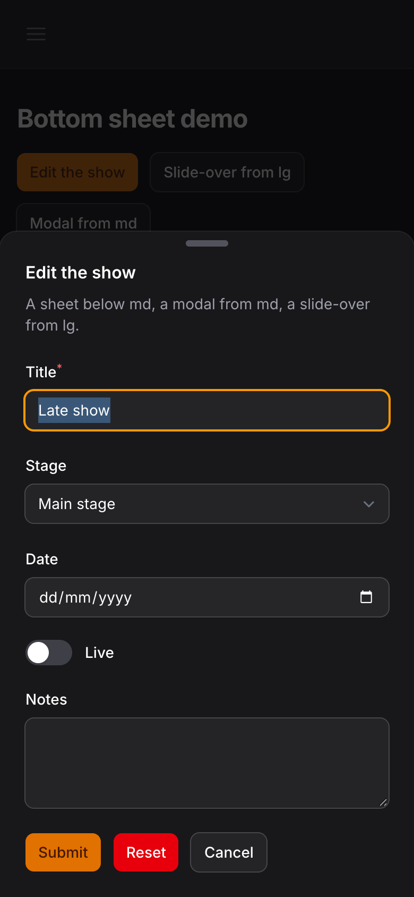
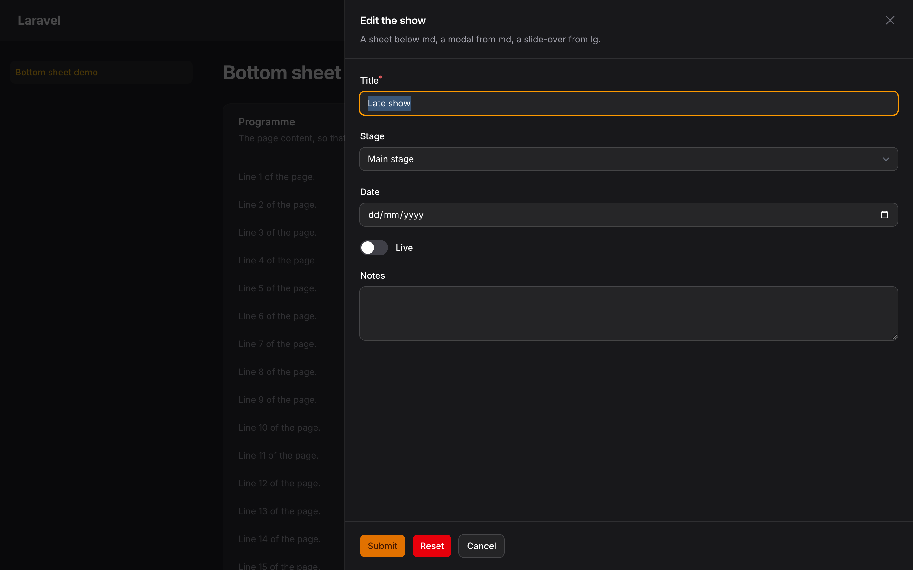
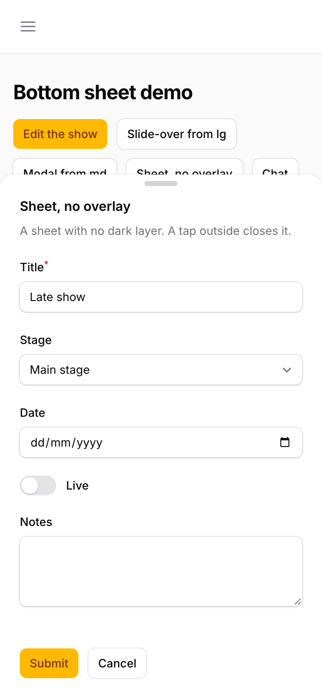
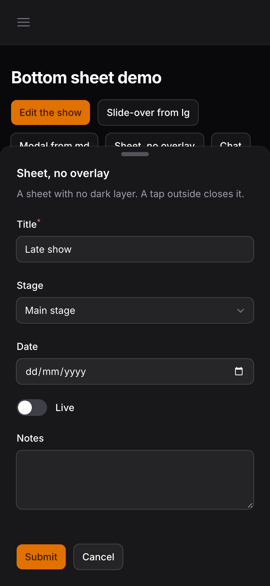
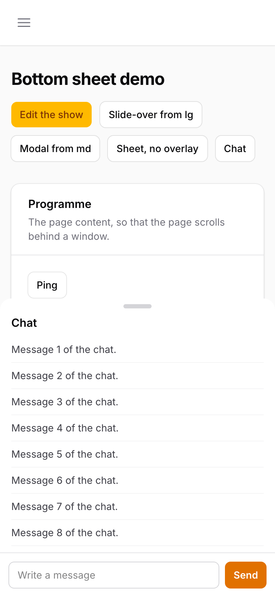
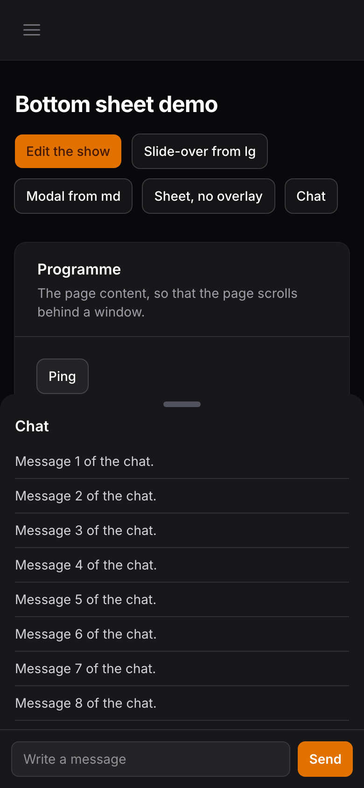
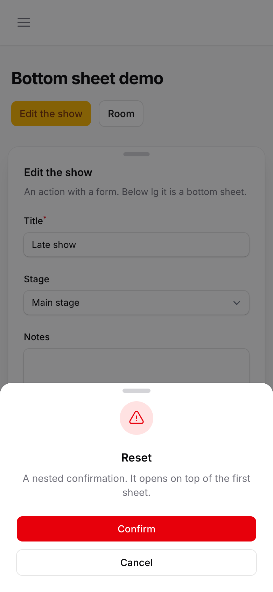

# Bottom sheets for Filament

[](https://packagist.org/packages/vtech9nl/filament-bottom-sheet)
[](https://github.com/VTech9NL/filament-bottom-sheet/actions/workflows/tests.yml)
[](https://packagist.org/packages/vtech9nl/filament-bottom-sheet)
[](LICENSE)

The bottom sheet is the third window type of a [Filament](https://filamentphp.com) v5 action, next to the modal and the slide-over. It is mobile first: `->bottomSheet()` makes the action a native bottom sheet, and `->modalFrom()` and `->slideOverFrom()` change the type from a breakpoint and up.

`x-bottom-sheet:element` gives the same sheet to any other element of a page, for example a chat that must stay mounted while it is closed.

<picture>
    <source media="(prefers-color-scheme: dark)" srcset="https://raw.githubusercontent.com/VTech9NL/filament-bottom-sheet/main/art/phone-sheet-dark.png">
    
</picture>

## Features

- **One action, three window types.** `->bottomSheet()->modalFrom('md')->slideOverFrom('lg')` is a sheet on a phone, a modal on a tablet and a slide-over on a desktop.
- **Phone behaviour.** Snap points at 25, 50, 75 and 100%, a free first height, drag, flick, scroll and dismiss. A second sheet stacks on the first.
- **One sheet for each part of a page.** An action and any other element use the same motion, options and look.
- **Filament look.** The modal and the slide-over use the Filament classes, so your theme styles them as Filament does.
- **No close on a resize.** A resize changes the type of an open window. The form data stays.

## Screenshots

The action `->bottomSheet()->modalFrom('md')->slideOverFrom('lg')`:

| Width | Light | Dark |
| --- | --- | --- |
| 390 px, sheet |  |  |
| 820 px, modal |  |  |
| 1440 px, slide-over |  |  |

The action `->bottomSheet(initialHeight: 0.75, overlay: false)`, and an element sheet (a chat) at 50%:

| Sheet | Light | Dark |
| --- | --- | --- |
| Action, 75%, no dark layer |  |  |
| Element, 50% |  |  |

A nested confirmation stacks on the first sheet:



## Requirements

- PHP 8.3 or higher
- Filament 5
- A custom panel theme that uses Tailwind CSS v4

## Installation

1. Install the package:

    ```bash
    composer require vtech9nl/filament-bottom-sheet
    ```

    Laravel registers the service provider. You add no plugin on the panel.

2. The panel theme needs `@source` for the directive classes of this package.

    Open the theme file, for example `resources/css/filament/admin/theme.css`:

    ```css
    @source '../../../../vendor/vtech9nl/filament-bottom-sheet/resources/js';
    ```

3. Build the theme:

    ```bash
    npm run build
    ```

Filament loads the package JavaScript and a small CSS file on each panel.

## Usage

### A sheet at each width

```php
use Filament\Actions\Action;

Action::make('edit')
    ->schema([
        // ...
    ])
    ->bottomSheet();
```

### The options

The options are named arguments of `->bottomSheet()`:

```php
Action::make('edit')
    ->bottomSheet(
        snapPoints: [0.25, 0.5, 0.75, 1.0],
        initialHeight: 0.75,
        overlay: false,
    )
    ->slideOverFrom('lg');
```

An argument that you do not give keeps its default. See [Options](#options).

### A sheet with no dark layer

```php
Action::make('edit')
    ->bottomSheet(overlay: false);
```

The page behind the sheet stays visible. A tap outside the sheet closes it, and the tap does not reach the page. The page does not scroll while the sheet is open. The modal type and the slide-over type keep the Filament overlay.

### A sheet, then a slide-over

```php
Action::make('edit')
    ->bottomSheet()
    ->slideOverFrom('lg');
```

Below `lg` (64rem), the action opens as a sheet. From `lg`, it opens as a Filament slide-over.

### A sheet, then a modal

```php
Action::make('edit')
    ->bottomSheet()
    ->modalFrom('md');
```

Below `md` (48rem), the action opens as a sheet. From `md`, it opens as the normal Filament modal, with the width of `modalWidth()`.

### A sheet, a modal and a slide-over

```php
Action::make('edit')
    ->bottomSheet()
    ->modalFrom('md')
    ->slideOverFrom('lg');
```

The order of the breakpoints is free. `->bottomSheet()->slideOverFrom('md')->modalFrom('lg')` is a sheet below `md`, a slide-over from `md` and a modal from `lg`.

### Nested actions

A nested action that must stack on a sheet needs `->overlayParentActions()`:

```php
Action::make('reset')
    ->requiresConfirmation()
    ->overlayParentActions()
    ->bottomSheet()
    ->modalFrom('md');
```

In a modal or a slide-over, a nested action behaves as in Filament.

### A sheet for any element

`x-bottom-sheet:element` makes an element of the page a sheet. The element stays in the DOM while the sheet is closed, so its state stays. An example of a chat:

```blade
<div
    x-data
    x-cloak
    x-bottom-sheet:element
    data-bottom-sheet-id="chat"
    data-bottom-sheet-initial-height="0.5"
    data-bottom-sheet-outside="pass"
    role="dialog"
    aria-label="Chat"
>
    <ul data-bottom-sheet-content>
        {{-- The messages: this part scrolls. --}}
    </ul>

    <form data-bottom-sheet-footer>
        <input type="text" aria-label="Message">
    </form>
</div>

<button x-on:click="$dispatch('bottom-sheet:open', { id: 'chat' })">
    Chat
</button>
```

The host attributes:

| Attribute | Default | Effect |
| --- | --- | --- |
| `data-bottom-sheet-id` | required | The name of the sheet in the events. |
| `data-bottom-sheet-snap-points` | `[0.25,0.5,0.75,1]` | A JSON array, as `snapPoints`. |
| `data-bottom-sheet-initial-height` | `0.5` | A number or `content`, as `initialHeight`. |
| `data-bottom-sheet-overlay` | `true` | `false` removes the dark layer, as `overlay`. |
| `data-bottom-sheet-outside` | none | `pass`: see [The outside tap](#the-outside-tap). |

The parts inside the host:

- `[data-bottom-sheet-content]`: the body that scrolls.
- `[data-bottom-sheet-footer]`: fixed at the bottom of the sheet. A drag does not start in it.
- `[data-bottom-sheet-handle]`: optional, a direct child of the host. With no handle, the directive adds one.

Put the content and the footer directly in the host, or in a wrapper that is a flex column of the full height. `x-cloak` hides the element until Alpine starts. A Livewire update keeps an open sheet at its height.

The expression is optional. `x-bottom-sheet:element="isPhone"` turns the sheet off while `isPhone` is false, and the element gets its own styles again. An open sheet comes back open.

The window events open and close a sheet: `bottom-sheet:open` and `bottom-sheet:close`, with `{ id }` in `detail`. Escape and a drag down also close it. The host sends these events, which bubble:

| Event | When |
| --- | --- |
| `bottom-sheet:opened` | The sheet starts to open. |
| `bottom-sheet:closed` | The sheet is closed. |
| `bottom-sheet:resize` | The visible height changes, also during the motion. |

Each `detail` has `id`, `height` (the visible height in px, `0` when closed) and `reason`: `drag`, `snap`, `outside`, `escape`, `event`, `viewport` or `focus`. The host also has the CSS variable `--bottom-sheet-height` with the visible height.

### The outside tap

| Sheet | Dark layer | A tap outside the sheet | Focus |
| --- | --- | --- | --- |
| `overlay: true` (the default) | yes | closes the top sheet | stays in the sheet |
| `overlay: false` | no | closes the top sheet, and does not reach the page | stays in the sheet |
| element sheet, `data-bottom-sheet-outside="pass"` | no | reaches the page, and the sheet stays open | free |

With `overlay` true or false, the page does not scroll while the sheet is open. At the close of an element sheet, the focus goes back to the element that opened it. A `pass` sheet is for a part that stays open while the user works on the page, for example a chat.

With two sheets open, only the top sheet takes an outside tap, Escape and the focus. A sheet under the top sheet lets a tap through and does not trap the focus. When it is the top sheet again, it takes the outside tap and traps the focus again.

A Filament modal that is not a bottom sheet is not in the sheet stack. When such a modal opens over an element sheet, Escape closes the element sheet, not the modal.

## Rules

These rules stop a wrong combination at once, with an `InvalidArgumentException`:

- `->bottomSheet()` cannot be used with `->slideOver()` or `->modal(false)`. Use `->slideOverFrom()` or `->modalFrom()`.
- `->modalFrom()`, `->slideOverFrom()` and the deprecated `->bottomSheetOverlay()` need `->bottomSheet()`.
- `->modalFrom()` and `->slideOverFrom()` cannot use the same breakpoint.
- A breakpoint name must be one of the names below.

The macros can be called in each order. The plugin checks the conflicts when Filament renders the action.

## Options

| Option | Default | Effect |
| --- | --- | --- |
| `bottomSheet($condition)` | on | The action is a sheet at each width that has no other type. `false`, or a closure that returns `false`, renders the action as Filament does. |
| `bottomSheet(snapPoints: $points)` | `[0.25, 0.5, 0.75, 1.0]` | Heights where the sheet rests after a drag, as parts of the visible viewport height. At `1.0`, the sheet fills the screen. The handle and the header stay below the top safe area. |
| `bottomSheet(initialHeight: $height)` | `'content'` | The height of each open. It can be any part of the viewport, not only a snap point. `'content'` opens at the height of the header, body and footer. When the content height cannot be measured, the sheet opens at `0.5`. |
| `bottomSheet(overlay: $condition)` | on | `false` hides the dark layer of the sheet type. A tap outside closes the sheet and does not reach the page. The modal type and the slide-over type keep the overlay. |
| `modalFrom($breakpoint)` | none | From this breakpoint and up, the action is the Filament modal. |
| `slideOverFrom($breakpoint)` | none | From this breakpoint and up, the action is a Filament slide-over. `slideOverPosition()` sets its side. |

An argument that is `null` does not change the option. The macros `bottomSheetSnapPoints()`, `bottomSheetInitialHeight()` and `bottomSheetOverlay()` still work, but they are deprecated. When you use a macro and an argument, the last call wins.

A value must be finite, more than 0 and at most 1. The snap points must be sorted and unique. A wrong value throws an `InvalidArgumentException`.

A focus on a text field in the top sheet moves the sheet to its highest snap point, as the keyboard opens. A sheet in a drag does not move. When the focus leaves, the sheet stays at its height.

With the keyboard open, the sheet stays above the keyboard and keeps its part of the visible viewport.

The breakpoint names are the Tailwind CSS v4 defaults:

| Name | Width |
| --- | --- |
| `sm` | 40rem |
| `md` | 48rem |
| `lg` | 64rem |
| `xl` | 80rem |
| `2xl` | 96rem |

## Upgrade from v0.1

- `->bottomSheet('lg')` and `->bottomSheet(true, 'lg')` become `->bottomSheet()->modalFrom('lg')`.
- `->slideOver()->bottomSheet('lg')` becomes `->bottomSheet()->slideOverFrom('lg')`.
- The section sheet is removed, with the `open-bottom-sheet` and `close-bottom-sheet` events. Make the section an action with `->bottomSheet()`, or let the app code show the section.
- The panel theme needs no `@source` for `src` now.
- The default snap points are `[0.25, 0.5, 0.75, 1.0]`. Before, they were `[0.5, 0.8, 1.0]`.
- The first height is free: the sheet opens at `initialHeight` and rests at a snap point only after a drag.
- `->bottomSheetSnapPoints()`, `->bottomSheetInitialHeight()` and `->bottomSheetOverlay()` are deprecated. Use `->bottomSheet(snapPoints: ..., initialHeight: ..., overlay: ...)`.
- With `overlay: false`, a tap outside the sheet closes it. The page behind does not take the tap.

## Limits

- A nested action stacks on a sheet only when it calls `->overlayParentActions()`.
- The slide-over type uses the sticky settings of the action, as a Filament slide-over does.
- `composer serve` builds the workbench theme and starts the demo panel.

## Testing

```bash
composer test
vendor/bin/pint --test
```

## Changelog

See [CHANGELOG.md](CHANGELOG.md).

## License

MIT. See [LICENSE](LICENSE).
